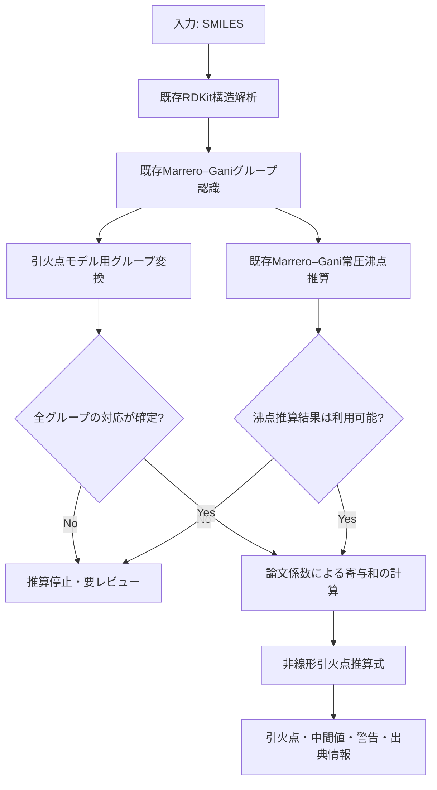

# PLAN: Marrero–Gani沸点推算を利用した引火点推算機能の開発方針

## 1. この計画書の目的

この `plan.md` は、`task.md` に記載した実装タスクの**背景・意図・全体像・判断基準**を説明するための計画書である。

- `plan.md`：なぜこの開発を行うのか、どのような考え方で進めるのか、何をもって成功とするのかを示す。
- `task.md`：実際に何を調査・実装・テストするのかを、実行可能なタスクに分解する。

実装担当者は、まず本書で全体方針を理解し、その後 `task.md` のTASK-001から順に作業すること。

## 2. 開発の背景

現在、化学構造（SMILES）からMarrero–Gani法のグループ寄与を認識し、常圧沸点を推算する機能が既に存在する。

今回の目的は、その既存機能を活用し、Serat et al. (2017) が提案した非線形グループ寄与モデルによる引火点推算機能を追加することである。

新規に構造認識や沸点推算を作り直すのではなく、既存機能を前段処理として再利用する。新たに実装する中心部分は、引火点モデル固有のグループ定義への変換、論文係数の管理、引火点計算、適用可否の判定である。

## 3. 目指す処理フロー

最終的には、SMILESを入力すると、構造認識、沸点推算、引火点モデル用グループ変換を経て、引火点と計算根拠を返す構成を目指す。

重要なのは、沸点推算と引火点モデル用グループ変換が、同じ構造解析結果を利用する独立した処理である点である。引火点モデル用のグループ定義を既存Marrero–Gani実装へ無理に組み込まない。

## 4. 設計上の中心課題

### 4.1 既存のグループ定義と引火点論文のグループ定義は同一ではない

既存のMarrero–Gani実装は、第1〜第3次の合計370グループを扱う。一方、引火点論文のモデルは合計294グループを使用する。

したがって、既存のグループカウントを、そのまま引火点論文の係数表へ渡すことはできない。

グループ番号や名称の一致を前提にすると、誤った係数が適用される可能性がある。グループの構造定義、SMARTS、結合環境、階層、カウント規則を比較し、化学構造上の根拠をもって対応関係を確定する必要がある。

このため、最初に実施するのがTASK-001（グループ定義・対応調査）である。

### 4.2 論文の係数を正確に取得する必要がある

引火点推算式だけを実装しても、グループ寄与係数が正確でなければモデルを再現できない。

本文だけでは全係数を取得できないため、Supplementary InformationのTables S2、S3、S4を確認する。係数は階層別に管理し、出典と照合状況を残す。

係数が不明な場合にゼロで補完したり、類似グループの係数を流用したりしてはならない。

このため、TASK-002で係数データを確定してから、変換・計算処理を実装する。

### 4.3 推算値だけでなく、計算根拠を追跡可能にする

引火点推算値だけを返す実装では、誤差や不具合が発生した際に原因を特定できない。

少なくとも以下を追跡可能にする。

- 入力SMILESと構造解析の状態
- 既存Marrero–Ganiグループのカウント
- 引火点モデル用グループへの変換結果
- 未対応・曖昧なグループとその理由
- 沸点推算値と推算状態
- 階層別の寄与和および合計値 \(A\)
- 使用した係数テーブルのバージョン
- 最終引火点と単位
- 警告・推算不可の理由

このトレーサビリティを、設計・データ形式・テストに一貫して反映する。

## 5. 開発の進め方

開発は、次の7段階で進める。前段の成果物が次段の入力となるため、原則として順序を入れ替えない。

### Phase 1：モデル定義の確認（TASK-001）

最初に、論文が定義する294グループと既存370グループを比較する。

ここではコードを急いで書かず、まず対応表と不確実な点を明確にする。対応が確定できないグループは「未対応」または「要レビュー」として残す。

**この段階の判断:** 既存構造認識結果から、引火点モデルに必要なグループカウントを正しく生成できるか。

### Phase 2：論文係数の確定（TASK-002）

Supplementary Informationから係数を取得し、階層別CSVにする。原資料との照合を行い、転記ミスや欠損を排除する。

**この段階の判断:** 引火点モデルの計算に必要な係数データが、出典を含めて確定しているか。

### Phase 3：グループ変換の実装（TASK-003）

確定した対応表に基づき、既存の構造解析結果を引火点モデル用のグループカウントに変換する。

変換不能な場合は、推算を続行せず理由を返す。変換層は既存のMarrero–Gani構造認識から独立させる。

**この段階の判断:** 変換結果が化学構造上妥当であり、すべてのグループの出所を追跡できるか。

### Phase 4：引火点計算の実装（TASK-004）

論文の式を実装する。係数の集計、非線形変換、単位、入力値の妥当性を個別にテストする。

計算関数と、構造認識・沸点推算を含む統合処理を分離する。

**この段階の判断:** 数式を独立して正しく計算でき、計算途中の値を検証できるか。

### Phase 5：論文計算例による再現（TASK-005）

Appendix Bに記載された5物質を使い、構造認識から引火点までの計算過程を照合する。

最終値だけでなく、グループカウント、沸点、寄与和、\(A\) の値を比較する。論文の記載に不整合が疑われる場合は、その事実を記録し、実装側で勝手に整合させない。

**この段階の判断:** 論文の計算手順を再現できているか。不一致がある場合、その原因を特定できているか。

### Phase 6：既存沸点推算との統合（TASK-006）

既存の `estimate_boiling_point()` を利用し、SMILESから引火点までの一連の処理をつなぐ。

沸点推算の `ok`、`uncertain`、`error` 等の状態を尊重し、信頼できない沸点を正常値として扱わない。

**この段階の判断:** 既存機能の互換性を維持しながら、一連の処理を安全に実行できるか。

### Phase 7：適用範囲・精度の評価（TASK-007）

論文の対象範囲・除外条件を整理し、実験引火点データとの比較を行う。

モデル単体の性能と、既存Marrero–Gani沸点推算を含む一連のシステムの性能を区別する。沸点誤差、構造認識誤差、グループ対応誤差、係数・モデル由来の誤差を可能な範囲で分けて評価する。

**この段階の判断:** どの化合物に適用でき、どの条件では推算を拒否すべきか、精度をどの程度期待できるかを説明できるか。

## 6. 品質・安全性の基本原則

この機能は化学物質の物性推算に用いるため、数値を返すことよりも、誤った数値を確からしく返さないことを重視する。

1. **根拠のない対応付けをしない。** グループ対応は構造定義に基づいて確定する。
2. **欠損を隠さない。** 係数やグループが不足する場合は推算不可または要レビューとする。
3. **既存機能を保護する。** 構造認識・沸点推算の変更は必要最小限にし、回帰テストを実施する。
4. **計算過程を残す。** 入力から最終値までのデータと係数の出典を追跡できるようにする。
5. **適用範囲を明示する。** 論文の対象外物質や混合物に対し、適用可能であるかのような出力をしない。
6. **論文の報告精度を保証値と誤認しない。** 本実装の精度は、独立したデータで評価する。

## 7. 最終的に実現したい利用方法

利用者はSMILESを入力し、引火点推算を実行する。正常に推算できた場合は、引火点だけでなく、沸点、グループカウント、寄与和、係数バージョン、警告を確認できる。

推算できない場合は、単にエラーとするのではなく、例えば以下のように原因を区別する。

- SMILESの解析に失敗した。
- 構造の一部を既存グループで認識できなかった。
- 引火点モデル用グループへの対応が確定していない。
- 係数テーブルに必要な係数がない。
- 沸点推算がエラーまたは不確実である。
- 論文モデルの適用範囲外である。

このように、推算値の有無だけでなく、その値をどの程度信頼してよいかを判断できる機能を目指す。

## 8. 参照資料と作業上のルール

- 参照論文：Serat et al. (2017), DOI: https://doi.org/10.1016/j.fluid.2017.06.008
- 係数の一次資料：論文Supplementary Information Tables S2、S3、S4
- 実装タスク・成果物・完了条件：`task.md`
- 既存Marrero–Ganiコード：作業開始時にリポジトリの実ファイルとAPIを確認する。

論文の記載、既存コードの実際の挙動、今回の設計判断を混同しないこと。資料から確認できない事項は「未確認」と明記し、推測を確定仕様として実装しない。

## 9. 成功の定義

この開発の成功は、単にSMILESから引火点の数値が出ることではない。

- 既存のMarrero–Gani構造認識と沸点推算を再利用できる。
- 引火点論文のグループ定義と係数を、根拠をもって正確に扱える。
- 論文の計算例を用いて計算過程を検証できる。
- 推算できない構造や不確実な入力を適切に検出できる。
- 推算値・中間値・出典・制約を追跡できる。
- 実験データに基づく精度と適用範囲を説明できる。

これらを満たすことで、物性値を返すだけでなく、計算根拠と限界を説明できる引火点推算機能とする。
